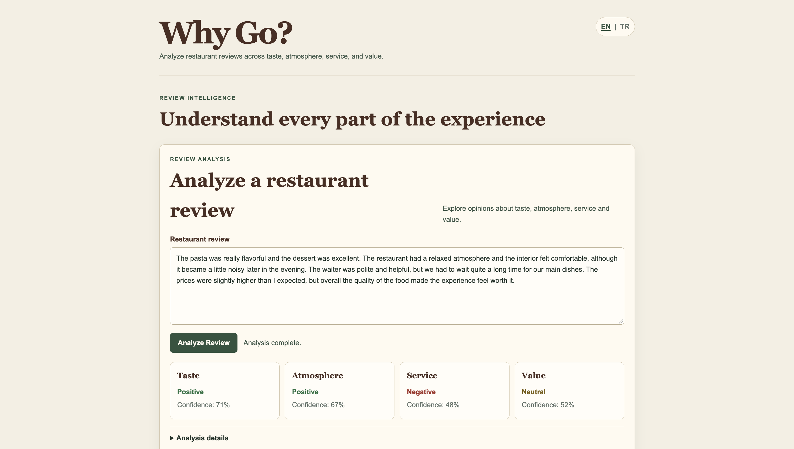

# Venue Review Analyzer

Multilingual aspect-based sentiment analysis for restaurant and café reviews in
Turkish, English, and Spanish. The system detects supported aspects in long
reviews and predicts sentiment only for the evidence sentences where those
aspects are present.

## Demo



## Key features

- Review analysis in Turkish, English, and Spanish
- English (default) and Turkish user interface
- Aspect detection for `taste`, `atmosphere`, `service`, and `value`
- `positive`, `neutral`, and `negative` sentiment classification
- Sentence-aware analysis and evidence-based review aggregation
- FastAPI backend and HTML/CSS/vanilla JavaScript frontend
- Optional PostgreSQL-backed legacy venue catalog

## Architecture

```text
User Review
    -> Frontend
    -> POST /analyze-review
    -> Sentence Segmentation
    -> Aspect Presence Detection
    -> Evidence Sentences
    -> XLM-RoBERTa + LoRA Sentiment
    -> Presence-weighted Review Aggregation
    -> Structured Result
```

The review analyzer does not require PostgreSQL. The database is used only by
the legacy `GET /places`, `GET /places/{id}`, and `POST /places` endpoints.

## Final results

Final checkpoints and thresholds were selected on development data. The test splits were opened once for final evaluation and were not used for tuning.

### Sentiment model

| Metric | Test result |
|---|---:|
| Accuracy | 0.8055 |
| Macro F1 | 0.6236 |
| Neutral F1 | 0.2511 |

| Language | Macro F1 |
|---|---:|
| Turkish | 0.6053 |
| English | 0.6271 |
| Spanish | 0.6322 |

Source: [`data/analysis/final_model_test_evaluation.txt`](data/analysis/final_model_test_evaluation.txt).

### Aspect-presence model

| Metric | Test result |
|---|---:|
| Macro F1 | 0.6825 |
| Micro F1 | 0.7292 |
| Exact Match | 0.6322 |
| All-zero exact accuracy | 0.7117 |

| Aspect | F1 |
|---|---:|
| Taste | 0.7558 |
| Atmosphere | 0.6222 |
| Service | 0.7648 |
| Value | 0.5871 |

Source: [`data/analysis/aspect_presence_final_test_evaluation.txt`](data/analysis/aspect_presence_final_test_evaluation.txt).

## Quick start

```bash
git clone https://github.com/ormnslm-sketch/venue-review-analyzer.git
cd venue-review-analyzer

python3 -m venv .venv
source .venv/bin/activate

.venv/bin/python -m pip install -r requirements.txt
.venv/bin/python -m pip install -r backend/requirements.txt
.venv/bin/python scripts/download_base_model.py

.venv/bin/python -m uvicorn backend.main:app --host 127.0.0.1 --port 8000 --reload
```

On Windows PowerShell, create and activate the environment with:

```powershell
py -m venv .venv
.venv\Scripts\Activate.ps1
```

After activation on Windows, use `python` in place of `.venv/bin/python` in
the commands below.

In a second terminal, start the static frontend:

```bash
.venv/bin/python -m http.server 5500 --directory frontend
```

Open `http://127.0.0.1:5500/`. PostgreSQL is not needed for `POST /analyze-review`.

## Why two models?

Aspect presence and aspect sentiment are separate tasks. The production aspect
detector uses TF-IDF word unigrams/bigrams with four independent Logistic
Regression classifiers. The sentiment component uses XLM-RoBERTa with a
trained LoRA adapter and classifier. An XLM-R + LoRA aspect detector was
evaluated but was not selected because it produced more false positives and
weaker all-zero rejection than the calibrated classical detector.

Development-calibrated aspect thresholds:

| Aspect | Threshold |
|---|---:|
| Taste | 0.50 |
| Atmosphere | 0.55 |
| Service | 0.50 |
| Value | 0.60 |

The sentiment model receives only detected aspects in this format:

```text
aspect=<aspect> [SEP] <evidence sentence>
```

## Models and artifacts

- Aspect presence: [`models/aspect_presence_logreg_v2/`](models/aspect_presence_logreg_v2/)
- Sentiment LoRA adapter and classifier: [`models/experiment_15_lora_expanded_balanced/best/epoch_2/`](models/experiment_15_lora_expanded_balanced/best/epoch_2/)
- Pretrained base: [`FacebookAI/xlm-roberta-base`](https://huggingface.co/FacebookAI/xlm-roberta-base)

Download the exact base-model files required by the frozen local inference loader:

```bash
.venv/bin/python scripts/download_base_model.py
```

Check an existing cache without network access:

```bash
.venv/bin/python scripts/download_base_model.py --check
```

Historical full XLM-R checkpoints and resumable training states are
intentionally excluded from Git and are not required for final inference. The
repository keeps the final project-specific LoRA/classifier and classical
detector artifacts. Third-party model and dataset terms are documented in
[`THIRD_PARTY_NOTICES.md`](THIRD_PARTY_NOTICES.md).

## API usage

### Analyze a review

```bash
curl -X POST http://127.0.0.1:8000/analyze-review \
  -H "Content-Type: application/json" \
  -d '{"text":"The pasta was delicious. The service was very slow."}'
```

Abbreviated real inference output from the final local pipeline:

```json
{
  "text": "The pasta was delicious. The service was very slow.",
  "sentence_count": 2,
  "aspects": {
    "taste": {
      "present": true,
      "presence_probability": 0.850192,
      "sentiment": "positive",
      "sentiment_confidence": 0.961626
    },
    "atmosphere": {
      "present": false,
      "presence_probability": 0.317040,
      "sentiment": null
    },
    "service": {
      "present": true,
      "presence_probability": 0.972795,
      "sentiment": "negative",
      "sentiment_confidence": 0.638525
    },
    "value": {
      "present": false,
      "presence_probability": 0.164945,
      "sentiment": null
    }
  },
  "no_target_aspects_detected": false,
  "sentiment_calls": 2
}
```

The full response also contains sentence-level probabilities, evidence
sentences, and per-class sentiment probabilities. Small floating-point
differences may occur across supported inference devices.

Command-line inference is also available:

```bash
.venv/bin/python src/analyze_review.py \
  --text "The pasta was delicious. The service was very slow." \
  --json
```

## Optional database setup

PostgreSQL is required only for the legacy `/places` catalog endpoints.

```bash
cp backend/.env.example backend/.env
psql -d mekan_ai -f backend/schema.sql
```

Configure these variables in the local `backend/.env` file:

- `DB_HOST`
- `DB_PORT`
- `DB_NAME`
- `DB_USER`
- `DB_PASSWORD`

The real `.env` is ignored by Git. [`backend/schema.sql`](backend/schema.sql)
uses `CREATE TABLE IF NOT EXISTS`, contains no credentials or destructive
statements, and reflects the verified legacy endpoint schema. Production
migration/versioning and seed data are outside the current repository scope.

## Project structure

```text
venue-review-analyzer/
├── backend/          # FastAPI and optional PostgreSQL integration
├── frontend/         # Static bilingual web interface
├── src/              # Data processing, evaluation, and inference
├── scripts/          # Setup and reproducibility utilities
├── models/           # Final artifacts and local experiment outputs
├── data/             # Processed data and analysis reports
├── tests/            # Python integration and frontend smoke tests
├── THIRD_PARTY_NOTICES.md
├── LICENSE
├── requirements.txt
└── README.md
```

## Development summary

Model development covered:

- multilingual ABSA preprocessing plus duplicate, conflict, and exact split-leakage audits;
- neutral-class imbalance analysis and classical baselines;
- controlled XLM-R/LoRA data, weighting, and language ablations;
- classical-versus-transformer aspect-presence comparison;
- untouched final test evaluation; and
- sentence-aware inference validation on long natural reviews.

Detailed experiment outputs are retained under
[`data/analysis/`](data/analysis/). Final production components remain frozen
after their one-time test evaluations.

## Data sources and attribution

- **M-ABSA:** primary multilingual restaurant-domain aspect annotations
- **MAMS:** human-reviewed English neutral examples
- **Project-authored neutral examples:** separately tracked English examples and reviewed Turkish/Spanish counterparts

Processed and expanded CSV files include data derived from upstream datasets
and are not presented as wholly independent datasets. Upstream attribution is
retained, while project-authored rows use separate provenance fields.
Third-party dataset/model licenses are distinct from this repository's
source-code license. See
[`THIRD_PARTY_NOTICES.md`](THIRD_PARTY_NOTICES.md) for sources, licenses, and
usage notes.

## Testing

Run the Python tests:

```bash
.venv/bin/python -m unittest discover -s tests -p "test_*.py" -v
```

Run the dependency-free frontend smoke test:

```bash
node tests/frontend_analyzer_smoke.js
```

Optional JavaScript syntax checks:

```bash
node --check frontend/js/i18n.js
node --check frontend/js/app.js
node --check frontend/js/details.js
node --check frontend/js/analyzer.js
```

Latest local verification: **22 passed, 0 failed**. These tests do not train models or evaluate final test datasets.

## Known limitations

- Broad food or dining statements can produce `taste` false positives.
- Subtle sentiment may be confused between `neutral` and `positive`.
- Only `taste`, `atmosphere`, `service`, and `value` are supported.
- Predictions are probabilistic and are not expected to be error-free.
- Sentence segmentation can affect evidence selection in long reviews.
- All-zero rejection is imperfect, and `value` remains the weakest aspect on the final test split.
- Deployment requires restricted CORS origins and a configurable frontend API base URL instead of localhost defaults.

## Future work

- Build a broader manually reviewed multilingual evaluation set.
- Add new aspects only with new annotation and evaluation work.
- Improve domain generalization across restaurant and café styles.
- Add venue-level aggregation across multiple reviews.
- Improve evidence presentation, deployment configuration, and model release workflows.

## References

- ChengYan Wu, Bolei Ma, Yihong Liu, Zheyu Zhang, Ningyuan Deng, Yanshu Li, Baolan Chen, Yi Zhang, Yun Xue, and Barbara Plank. **“M-ABSA: A Multilingual Dataset for Aspect-Based Sentiment Analysis.”** EMNLP 2025. [ACL Anthology](https://aclanthology.org/2025.emnlp-main.128/). DOI: [`10.18653/v1/2025.emnlp-main.128`](https://doi.org/10.18653/v1/2025.emnlp-main.128).
- Qingnan Jiang, Lei Chen, Ruifeng Xu, Xiang Ao, and Min Yang. **“A Challenge Dataset and Effective Models for Aspect-Based Sentiment Analysis.”** EMNLP-IJCNLP 2019. [ACL Anthology](https://aclanthology.org/D19-1654/). DOI: [`10.18653/v1/D19-1654`](https://doi.org/10.18653/v1/D19-1654).
- Pretrained base model: [`FacebookAI/xlm-roberta-base`](https://huggingface.co/FacebookAI/xlm-roberta-base), model metadata license MIT.

## License

Repository source code is licensed under the [MIT License](LICENSE).
Third-party datasets, model weights, and derived artifacts remain subject to
their own terms; see [`THIRD_PARTY_NOTICES.md`](THIRD_PARTY_NOTICES.md).
